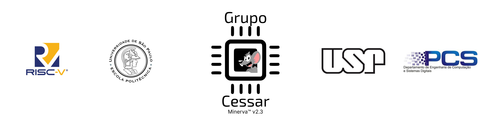
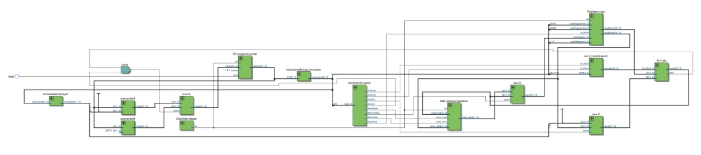
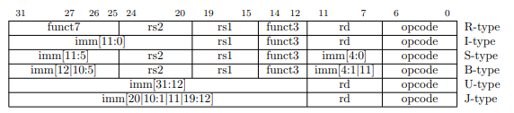

<p align="center">
  
</p>

# Single-cycle RISC-V processor in Verilog

**English** | [Português](README.pt-BR.md)

## Description

A **single-cycle RISC-V processor (RV32I subset)** written in Verilog, built as the project for **PCS3115 – Digital Systems I** at the Polytechnic School of the University of São Paulo (Escola Politécnica da USP, 2022) by Group 3 (Grupo Cessar):

- [Celso Tadaki Sinoka](https://github.com/C-Tadaki-S)
- [Henrique Gregory Gimenez](https://github.com/henriquegreg)
- [João Felipe de Souza Melo](https://github.com/jofe2003)
- [Lucas Suzin Bertan](https://github.com/bertanbee)

The processor runs a program preloaded into the Instruction Memory: the **number-guessing game** ("Numle") from the first assignment of MAC2166 – Introduction to Computer Science. The secret number and the player's guesses are stored in the Data Memory, and the result (1 = guessed right, 0 = out of guesses) is written to address 13 of that memory and copied into register `x4`.

Each datapath block (ALU, control, registers, memories, immediate generator, mux, adders) is a separate module with its own testbench, commented code and documentation in [`docs/modules/`](docs/modules/) (in Portuguese).

The original C code of the game, its instruction-by-instruction translation to RISC-V and the simulation waveforms are in [`docs/modules/instruction_memory.md`](docs/modules/instruction_memory.md).


Synthesized circuit:



The design was also implemented on an FPGA (Intel Cyclone V):


### Supported instructions

| Instruction | Type | Description |
|---|---|---|
| `add` | R | `rd = rs1 + rs2` |
| `sub` | R | `rd = rs1 - rs2` |
| `and` | R | `rd = rs1 & rs2` (bitwise) |
| `or`  | R | `rd = rs1 \| rs2` (bitwise) |
| `lw`  | I | `rd = Mem[rs1 + imm]` |
| `sw`  | S | `Mem[rs1 + imm] = rs2` |
| `beq` | B | if `rs1 == rs2` (subtraction is zero), `PC = PC + imm` |



| Field | Meaning |
|---|---|
| `rs1`, `rs2` | source registers |
| `rd` | destination register (`x0` is always zero) |
| `imm` | immediate value encoded in the instruction |
| `opcode` | identifies the instruction format (R, I, S, B…) |
| `funct3`, `funct7` | distinguish instructions that share an opcode (e.g. `add` vs. `sub`) |

### Differences from RV32I

This is a simplified subset that departs from the specification in a few ways:

- **Word addressing:** the PC advances by 1 (not 4), and `lw`/`sw` addresses also count words. The Instruction Memory holds 64 32-bit words and the Data Memory holds 32.
- **`beq` offset in instructions:** the target is `PC + imm`, without the standard 1-bit shift.
- **Unsigned immediates:** they are zero-extended, so only forward branches and positive `lw`/`sw` offsets are possible.
- **Only 7 instructions:** there is no `addi`, `jal`, `jalr` or any other branch.

## Requirements

- [Icarus Verilog](https://steveicarus.github.io/iverilog/) (`iverilog` and `vvp`) — compilation and simulation
- [GTKWave](https://gtkwave.sourceforge.net/) — waveform viewer
- `make`
- Optional: [Questa – Intel FPGA Edition](https://www.intel.com/content/www/us/en/software/programmable/quartus-prime/questa-edition.html) — alternative simulator
- Optional: Intel Quartus Prime — synthesis for the Cyclone V FPGA
- Optional: `gcc` — to build the Data Memory generator
- Optional: Python 3 — to redraw the program diagram

## Installation

There is no build step: clone the repository and install the tools.

```bash
git clone https://github.com/jofe2003/-rv32i-single-cycle-cpu.git
cd -- -rv32i-single-cycle-cpu
```

Ubuntu/Debian:

```bash
sudo apt install iverilog gtkwave make
```

macOS (Homebrew):

```bash
brew install icarus-verilog
```

On macOS, install GTKWave following the instructions on its [official website](https://gtkwave.sourceforge.net/).

## Usage

Run every command from the repository root. Generated files go to `build/`.

### Simulate the full processor

```bash
make sim     # compiles and simulates; writes build/my_dumpfile.vcd
make wave    # opens the waveforms in GTKWave
```

The VCD contains the signals of the `riscv` module and its submodules. Memory contents are not dumped to the VCD; to see the game result, open `testbench` → `UUT` → `regs` → `register4` (register `x4`), which receives the result at the end of the program. The PC is `testbench` → `UUT` → `instructionAdress`.


### Test the modules

```bash
make test               # runs every testbench
make test-alu           # runs a single one
make docs               # redraws the program diagram from the binary
make clean              # deletes build/
```

Available testbenches: `alu`, `alu_control`, `control_unit`, `data_memory`, `imm_gen`, `instruction_memory`, `pc`, `register_file`, `mux2`, `random_gen`.

To use Questa, compile the same files the `Makefile` lists for each testbench:

```bash
vlog rtl/common/mux2.v tb/mux2_tb.v
vsim -c work.testbench -do "run -all; quit"
```

### Change the game inputs

`tools/generate_datamem.c` generates a new Data Memory with the secret number and guesses of your choice:

```bash
gcc tools/generate_datamem.c -o tools/generator
printf "4\n3\n1\n2\n3\n" | ./tools/generator > rtl/memory/data_memory.v
make sim
```

Inputs, one per line: the secret number (0–9), the number of guesses *n* (0–10) and the *n* guesses (0–9 each). Memory layout: address 0 = secret, 1 = *n*, 2 to 11 = guesses, 12 = constant 1 and 13 = result. Note: this **overwrites** `rtl/memory/data_memory.v`; run `git checkout rtl/memory/data_memory.v` to restore the original.

## Project structure

```
.
├── rtl/                          # synthesizable code
│   ├── riscv_top.v               # top-level module: wires every datapath block
│   ├── core/
│   │   ├── control_unit.v        # main control unit (decodes the opcode)
│   │   ├── alu_control.v         # ALU control (ALUOp + funct → operation)
│   │   ├── imm_gen.v             # extracts the immediate from I, S and B formats
│   │   ├── register_file.v       # 32-register file
│   │   └── pc.v                  # Program Counter
│   ├── alu/
│   │   ├── alu.v                 # ALU: add, sub, and, or
│   │   └── ops/                  # look-ahead adder/subtractor, and, or
│   ├── memory/
│   │   ├── instruction_memory.v  # the game program in binary
│   │   └── data_memory.v         # secret number, guesses and result
│   └── common/
│       ├── adder32.v             # 32-bit adder (PC + 1, PC + imm)
│       ├── lookahead_1b.v        # 1-bit adder cell
│       ├── mux2.v                # 32-bit 2:1 multiplexer
│       └── clock_gen.v           # clock generator (100 ns period)
├── tb/                           # testbenches (<module>_tb.v)
├── tools/
│   ├── generate_datamem.c        # generates rtl/memory/data_memory.v
│   └── draw_program.py           # draws the program diagram (make docs)
├── extras/
│   └── random_gen/               # pseudo-random generator (not part of the datapath)
├── docs/
│   ├── modules/                  # per-module documentation (Portuguese)
│   └── img/                      # diagrams, synthesized circuits and screenshots
├── LICENSE
├── Makefile
├── README.md                     # this file
└── README.pt-BR.md               # Portuguese version
```

### Module documentation (Portuguese)

| Module | Documentation |
|---|---|
| ALU | [alu.md](docs/modules/alu.md) |
| ALU Control | [alu_control.md](docs/modules/alu_control.md) |
| Control Unit | [control_unit.md](docs/modules/control_unit.md) |
| Immediate Generator | [imm_gen.md](docs/modules/imm_gen.md) |
| Registers and PC | [registers.md](docs/modules/registers.md) |
| Instruction Memory | [instruction_memory.md](docs/modules/instruction_memory.md) |
| Data Memory | [data_memory.md](docs/modules/data_memory.md) |
| Multiplexer | [mux2.md](docs/modules/mux2.md) |
| Adder | [adder32.md](docs/modules/adder32.md) |
| Clock Generator | [clock_gen.md](docs/modules/clock_gen.md) |
| Random generator (extra) | [random_gen.md](docs/modules/random_gen.md) |

## Hardware

The design was synthesized for the **[Intel Cyclone V](https://www.intel.com/content/www/us/en/products/details/fpga/cyclone/v.html)** FPGA. In a 2022 survey of the Brazilian market, Cyclone V development kits started at R$ 1,500; standalone boards were only found for the previous generation, the Cyclone IV, at R$ 200–300. Another option aimed at learning RISC-V is the [Perf-V](https://perfv.org/) board.

## License

Released under the [MIT License](LICENSE).

## References

- Waterman, A. et al. *The RISC-V Instruction Set Manual, Volume I: User-Level ISA*, v2.2. SiFive, 2017. https://riscv.org/wp-content/uploads/2017/05/riscv-spec-v2.2.pdf
- Patterson, D.; Hennessy, J. *Computer Organization and Design: RISC-V Edition*. 2018.
- Patterson, D.; Waterman, A. *The RISC-V Reader: An Open Architecture Atlas*. 2017. Portuguese edition: http://riscvbook.com/portuguese/guia-pratico-risc-v-1.0.0.pdf
- Azevedo, R. J. YouTube channel. https://www.youtube.com/@rjazevedo
- Albertini, B. *Sistemas Digitais* (Digital Systems). https://balbertini.github.io/pages/sd-pt_BR.html#sd
