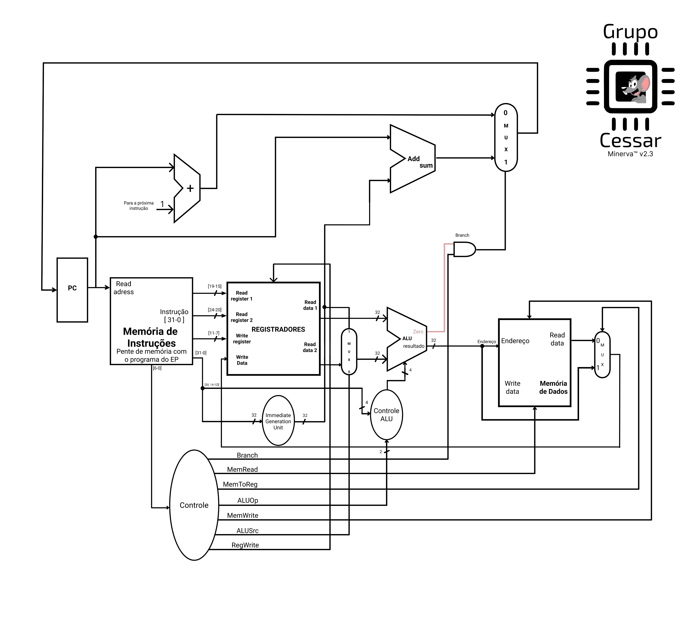
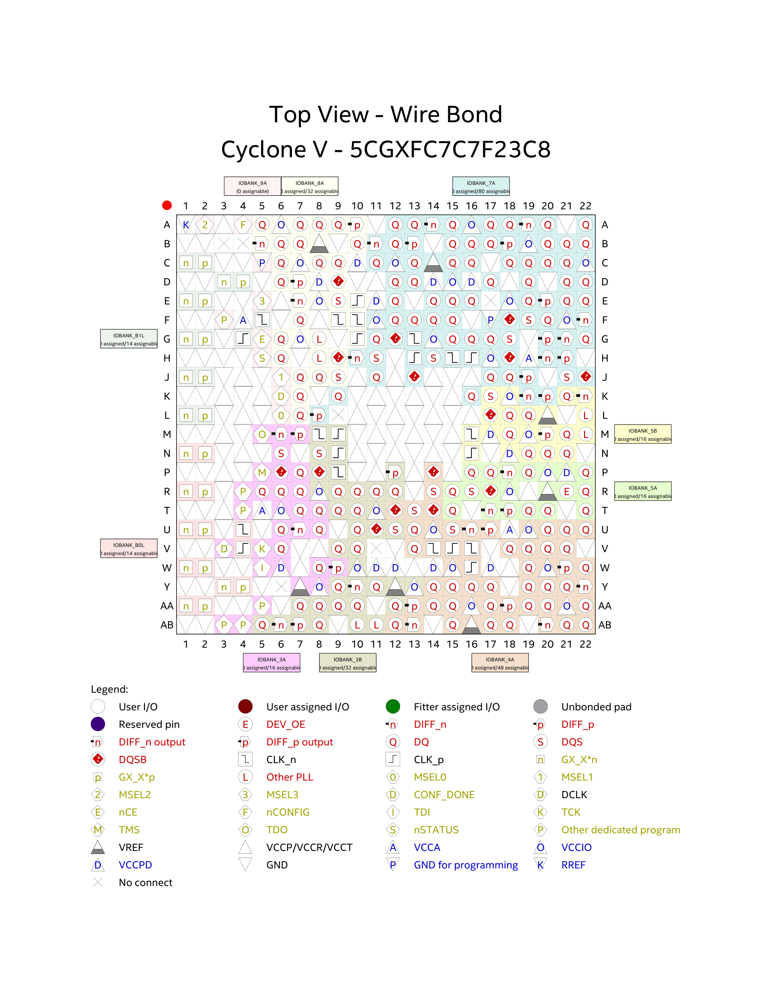
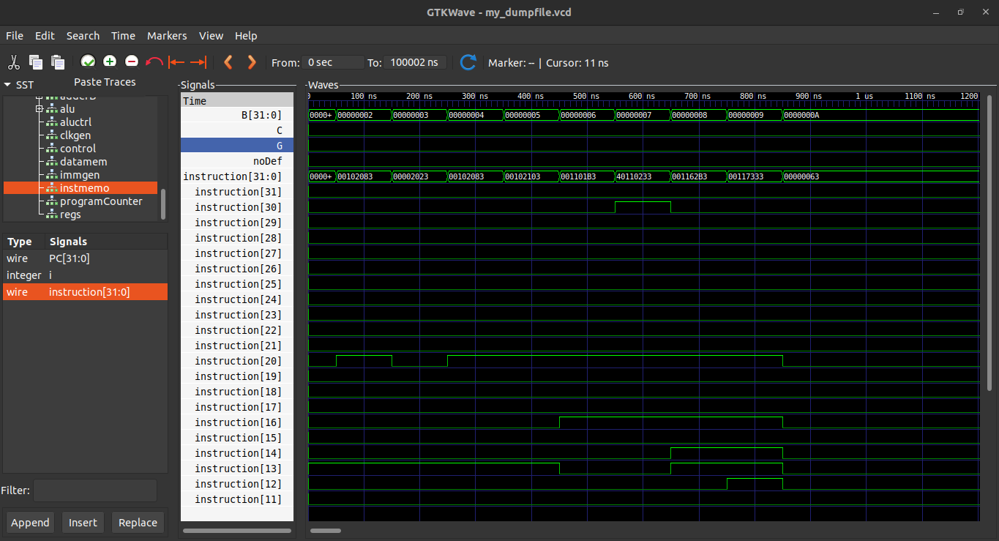

<p align="center">
  
</p>

# Processador RISC-V monociclo em Verilog

## Descrição

Implementação de um processador **RISC-V monociclo (subconjunto RV32I)** em Verilog, feita como projeto da disciplina **PCS3115 – Sistemas Digitais I** da Escola Politécnica da USP (2022) pelo Grupo 3 (Grupo Cessar):

- [Celso Tadaki Sinoka](https://github.com/C-Tadaki-S)
- [Henrique Gregory Gimenez](https://github.com/henriquegreg)
- [João Felipe de Souza Melo](https://github.com/jofe2003)
- [Lucas Suzin Bertan](https://github.com/bertanbee)

O processador roda um programa já carregado na Memória de Instruções: o **jogo de adivinhação** ("Numle") do EP0 da disciplina MAC2166 – Introdução à Computação. A senha e as tentativas do jogador ficam na Memória de Dados, e o resultado (1 = acertou, 0 = errou) é escrito de volta nela.

Cada bloco do datapath (ALU, controle, registradores, memórias, gerador de imediatos, mux, somadores) é um módulo separado, com testbench própria, comentários no código e documentação em [`docs/modules/`](docs/modules/).

O código C original do jogo, a tradução instrução por instrução para RISC-V e as formas de onda da simulação estão em [`docs/modules/instruction_memory.md`](docs/modules/instruction_memory.md).



Circuito sintetizado:


Também foi feita uma implementação para FPGA (Intel Cyclone V):



### Instruções suportadas

| Instrução | Tipo | Descrição |
|---|---|---|
| `add` | R | `rd = rs1 + rs2` |
| `sub` | R | `rd = rs1 - rs2` |
| `and` | R | `rd = rs1 & rs2` (bit a bit) |
| `or`  | R | `rd = rs1 \| rs2` (bit a bit) |
| `lw`  | I | `rd = Mem[rs1 + imm]` |
| `sw`  | S | `Mem[rs1 + imm] = rs2` |
| `beq` | B | se `rs1 == rs2` (subtração dá zero), `PC = PC + imm` |


| Campo | Significado |
|---|---|
| `rs1`, `rs2` | registradores de origem |
| `rd` | registrador de destino (`x0` vale sempre zero) |
| `imm` | valor imediato embutido na instrução |
| `opcode` | identifica o tipo de instrução (R, I, S, B…) |
| `funct3`, `funct7` | diferenciam instruções com o mesmo opcode (ex.: `add` × `sub`) |

> **Observação:** as memórias são endereçadas por palavra, ou seja, o PC avança de 1 em 1 (e não de 4 em 4 como no RISC-V padrão). A Memória de Dados tem 32 palavras de 32 bits e a de Instruções, 64.

## Requisitos

- [Icarus Verilog](https://steveicarus.github.io/iverilog/) (`iverilog` e `vvp`) — compilação e simulação
- [GTKWave](https://gtkwave.sourceforge.net/) — visualização das formas de onda
- `make`
- Opcional: [Questa – Intel FPGA Edition](https://www.intel.com/content/www/us/en/software/programmable/quartus-prime/questa-edition.html) — simulador alternativo
- Opcional: Intel Quartus Prime — síntese para FPGA Cyclone V
- Opcional: `gcc` — para compilar o gerador da Memória de Dados

## Instalação

Não há etapa de build: basta clonar o repositório e instalar as ferramentas.

```bash
git clone https://github.com/jofe2003/-rv32i-single-cycle-cpu.git
cd -- -rv32i-single-cycle-cpu
```

Ubuntu/Debian:

```bash
sudo apt install iverilog gtkwave make
```

macOS (Homebrew):

```bash
brew install icarus-verilog
brew install --cask gtkwave
```

## Uso

Todos os comandos são executados na raiz do repositório. Os arquivos gerados vão para `build/`.

### Simular o processador completo

```bash
make sim     # compila e simula; gera build/my_dumpfile.vcd
make wave    # abre as formas de onda no GTKWave
```

O VCD contém todos os sinais do módulo `riscv`. No GTKWave, o resultado do jogo pode ser visto na Memória de Dados:



### Testar os módulos

```bash
make test               # roda todas as testbenches
make test-alu           # roda só uma
make clean              # apaga build/
```

Testbenches disponíveis: `alu`, `alu_control`, `control_unit`, `data_memory`, `imm_gen`, `instruction_memory`, `pc`, `register_file`, `mux2`, `random_gen`.

Para usar o Questa, compile os mesmos arquivos que o `Makefile` lista para cada testbench:

```bash
vlog rtl/common/mux2.v tb/mux2_tb.v
vsim -c work.testbench -do "run -all; quit"
```

### Mudar as entradas do jogo

O programa `tools/generate_datamem.c` gera uma nova Memória de Dados com a senha e as tentativas que você escolher:

```bash
gcc tools/generate_datamem.c -o tools/generator
printf "4\n3\n1\n2\n3\n" | ./tools/generator > rtl/memory/data_memory.v
make sim
```

Entradas, uma por linha: a senha (0–9), o número de tentativas *n* (0–9) e as *n* tentativas (0–9 cada). Atenção: isso **sobrescreve** `rtl/memory/data_memory.v`; use `git checkout rtl/memory/data_memory.v` para voltar ao original.

## Estrutura de pastas

```
.
├── rtl/                          # código sintetizável
│   ├── riscv_top.v               # módulo topo: liga todos os blocos do datapath
│   ├── core/
│   │   ├── control_unit.v        # unidade de controle (decodifica o opcode)
│   │   ├── alu_control.v         # controle da ALU (ALUOp + funct → operação)
│   │   ├── imm_gen.v             # extrai o imediato dos formatos I, S e B
│   │   ├── register_file.v       # banco de 32 registradores
│   │   └── pc.v                  # Program Counter
│   ├── alu/
│   │   ├── alu.v                 # ALU: add, sub, and, or
│   │   └── ops/                  # somador/subtrator look-ahead, and, or
│   ├── memory/
│   │   ├── instruction_memory.v  # programa do jogo em binário
│   │   └── data_memory.v         # senha, tentativas e resultado
│   └── common/
│       ├── adder32.v             # somador de 32 bits (PC + 1, PC + imm)
│       ├── lookahead_1b.v        # célula de 1 bit do somador
│       ├── mux2.v                # multiplexador 2:1 de 32 bits
│       └── clock_gen.v           # gerador de clock (período de 100 ns)
├── tb/                           # testbenches (<módulo>_tb.v)
├── tools/
│   └── generate_datamem.c        # gera rtl/memory/data_memory.v
├── extras/
│   └── random_gen/               # gerador pseudoaleatório (fora do datapath)
├── docs/
│   ├── modules/                  # documentação de cada módulo
│   └── img/                      # diagramas, circuitos sintetizados e capturas
├── Makefile
└── README.md
```

### Documentação dos módulos

| Módulo | Documentação |
|---|---|
| ALU | [alu.md](docs/modules/alu.md) |
| Controle da ALU | [alu_control.md](docs/modules/alu_control.md) |
| Unidade de Controle | [control_unit.md](docs/modules/control_unit.md) |
| Gerador de Imediatos | [imm_gen.md](docs/modules/imm_gen.md) |
| Registradores e PC | [registers.md](docs/modules/registers.md) |
| Memória de Instruções | [instruction_memory.md](docs/modules/instruction_memory.md) |
| Memória de Dados | [data_memory.md](docs/modules/data_memory.md) |
| Multiplexador | [mux2.md](docs/modules/mux2.md) |
| Somador | [adder32.md](docs/modules/adder32.md) |
| Gerador de Clock | [clock_gen.md](docs/modules/clock_gen.md) |
| Gerador aleatório (extra) | [random_gen.md](docs/modules/random_gen.md) |

## Hardware

A síntese foi feita para a FPGA **[Intel Cyclone V](https://www.intel.com/content/www/us/en/products/details/fpga/cyclone/v.html)**. No levantamento de custos feito em 2022, os kits de desenvolvimento com Cyclone V custavam a partir de R$ 1.500. Só achamos preço da placa avulsa para a geração anterior, a Cyclone IV, entre R$ 200 e R$ 300. Outra alternativa voltada ao ensino de RISC-V é a placa [Perf-V](https://perfv.org/).

## Referências

- Waterman, A. et al. *The RISC-V Instruction Set Manual, Volume I: User-Level ISA*, v2.2. SiFive, 2017. https://riscv.org/wp-content/uploads/2017/05/riscv-spec-v2.2.pdf
- Patterson, D.; Hennessy, J. *Computer Organization and Design: RISC-V Edition*. 2018.
- Patterson, D.; Waterman, A. *Guia Prático RISC-V: Atlas de uma Arquitetura Aberta*. 2019. http://riscvbook.com/portuguese/guia-pratico-risc-v-1.0.0.pdf
- Azevedo, R. J. Canal no YouTube. https://www.youtube.com/@rjazevedo
- Albertini, B. *Sistemas Digitais*. https://balbertini.github.io/pages/sd-pt_BR.html#sd
